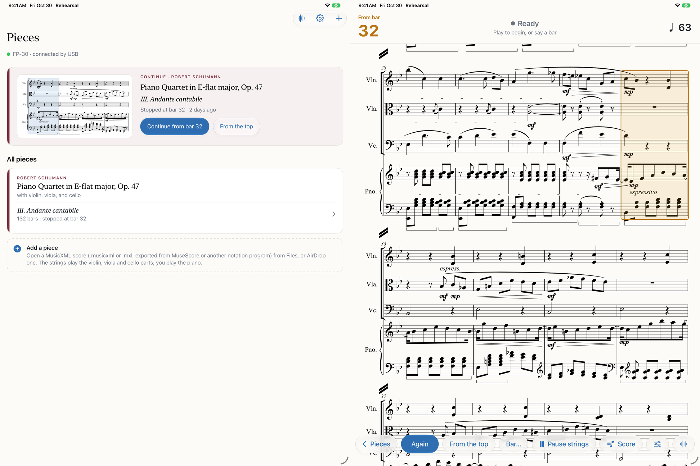

# Rehearsal

**A string trio that follows you at the piano.**

Rehearsal is an iPad app for pianists who are learning chamber music. You plug a digital piano into the iPad and
play your part from the score on the screen. A virtual violin, viola and cello play the other parts, following
your tempo as you speed up, slow down, stop and start again. Say "again", "from bar 32" or "from the top" while
the strings wait, and they come in where you ask.

It began with Schumann's Piano Quartet, Op. 47 (the third movement), and it can take any piece with a piano part
and up to one each of violin, viola and cello. You add a piece from a MusicXML file. Nothing needs marking up by
hand.



*Left: the library. Right: the rehearse screen, waiting to start from bar 32 (outlined). The controls show only
while the strings are stopped.*

> **Status:** a working prototype, used daily by one pianist. Expect rough edges.

## What you need

- An iPad running iPadOS 26 or later.
- A digital piano with USB MIDI, connected to the iPad (USB-C, or a camera adapter). It was developed with a
  Roland FP-30; any class-compliant MIDI keyboard should work. The piano plays through its own speakers and the
  iPad plays the strings.
- A Mac with Xcode, to build and install the app (there is no App Store version).

## Install the app

1. Open `ios/App/Rehearsal.xcodeproj` in Xcode.
2. Under *Signing & Capabilities*, pick your own team (a free Apple ID works), and change the bundle identifier
   (`kz.justinlim.rehearsal`) to one of your own.
3. Connect the iPad, turn on *Developer Mode* on it, choose it as the run destination, and press Run.

With a free Apple ID, the app stops opening after 7 days. Build and install it again to renew it. A paid Apple
Developer account removes the limit.

## Add a piece

1. Get the piece as **MusicXML**: a `.mxl` (compressed) or `.musicxml` file. Every notation program exports it
   (MuseScore: *File › Export › MusicXML*). Many scores on [MuseScore](https://musescore.com) and elsewhere can
   be downloaded as MusicXML; check the score's licence.
2. Put the file in Files (iCloud Drive or *On My iPad*), or AirDrop it to the iPad.
3. In the app, tap **Add a piece** and choose the file, or open the file and pick Rehearsal. Check the preview
   and tap **Add**.

What the app reads from the score:

- **The parts.** It looks for parts named Piano, Violin, Viola and Cello (or Violoncello), in the usual spellings
  and abbreviations (Vln., Vla., Vc., Pno., and so on). You play the piano part; the strings play the others.
  Other parts are shown in the score but not played. The score needs exactly one piano part and at most one of
  each string instrument.
- **Repeats** are played out, with first and second endings. D.C. and D.S. are not followed yet.
- **Dynamics** (*pp* to *ff*), hairpins, and *cresc.*/*dim.* shape how loudly the strings play.
- **The title and composer** come from the file's work and movement titles and its composer.

## Rehearse

- Choose a piece and play. The strings come in with you.
- When you stop, the strings trail off and wait. Then say, or tap:
  - **"Again"**: the passage you just played, from where you started it.
  - **"From bar 32"**, **"From the top"**: start there.
  - **"Pause"** and **"Resume"**: practise a passage on your own while the strings wait.
- **Strings** sets each instrument's volume and the opening tempo. **Score** chooses which parts to show (the full
  score, or your part alone) and how large.
- Every session is saved as a MIDI file in the app's folder in Files, with a summary of each pass.

## The Mac tools

The engine was written in Python first. That version is kept as the reference the iPad's Swift engine is checked
against, along with a few tools. You need [uv](https://docs.astral.sh/uv/).

```sh
uv run rehearsal bars --first 1 --last 8             # the score's bars, part by part
uv run rehearsal simulate take.mid                   # the strings on a recorded take, offline, as a MIDI file
uv run rehearsal session session.mid                 # timing of a session saved on the iPad
uv run rehearsal bundle --score <file.mxl> --out ~/Desktop/<name>.rehearsal
                                                    # a piece folder for the iPad, made on the Mac
```

### Tests

```sh
uv run pytest -q                                                      # the Python engine
swift run --package-path ios/RehearsalCore fixture-check              # the iPad engine plays what Python plays
swift run --package-path ios/RehearsalCore import-check               # the iPad reads MusicXML as the Mac does
```

`fixture-check` runs recorded takes and sessions through the Swift engine and compares every note it plays with
the Python engine's output. `import-check` reads test scores (`tests/musicxml/`, and the scores in `scores/`) the
iPad's way and compares the notes, bars and dynamics with the Mac's reading. To regenerate both sets of
expected results:
`uv run rehearsal bundle --fixtures ios/Fixtures --import-fixtures ios/ImportFixtures` (the takes it replays
are kept out of the repository, so this works only where they are).

## How it fits together

| Path | What |
|---|---|
| `ios/App/` | The iPad app (SwiftUI): library, rehearse screen, strings, piano input, voice cues, recordings. |
| `ios/RehearsalCore/` | The engine in Swift, as a package: score reading, tempo, the accompanist, dynamics, with the two checks above. |
| `ios/Web/score.html` | The score page: Verovio engraves the MusicXML on the iPad and the page follows along. |
| `rehearsal/` | The Python reference engine: score reading (`musicxml.py`, `score.py`), tempo (`tempo.py`), the accompanist (`accompanist.py`), dynamics (`dynamics.py`), offline runs and the tools above. |
| `ios/Sounds/strings.sf2` | Violin, viola and cello, cut from MuseScore's MS Basic SoundFont. |
| `tone/` | Listening tests for the strings' sound: renders, scorecards, blind comparison pages (`tone/README.md`). |
| `docs/NOTES.md` | The development log: decisions, measurements, and what was tried. `docs/HANDOFF.md` is the original brief. |

## Credits and licences

- Strings: the violin, viola and cello of MuseScore's [MS Basic](https://github.com/musescore/MuseScore)
  SoundFont (MuseScore_General, by S. Christian Collins), which builds on FluidR3Mono by Michael Cowgill and Fluid
  (R3) by Frank Wen. MIT licence; the notices are in `ios/Sounds/LICENSE-MS-Basic.md`. The Mac tools
  cut them from the SoundFont as MuseScore Studio installs it (`rehearsal/sf2strings.py`).
- Score engraving: [Verovio](https://www.verovio.org), LGPL-3.0-or-later, loaded unmodified as a separate file
  (`ios/Web/README.md`).
- Speech: Apple's on-device speech recognition.
- The Python tools use mido, NumPy and PyYAML (MIT and BSD licences).
- The listening tests in `tone/` download their reference recordings and samples when run; none are part of the
  repository. They come from the University of Iowa Musical Instrument Samples, VSCO-2 Community Edition (CC0),
  Karoryfer's Big Cat cello (CC0) and Wikimedia Commons (CC0, public domain, CC BY or CC BY-SA, recorded per file).
  Some of them use FluidSynth (LGPL-2.1), Demucs (MIT) and Google's DDSP (Apache 2.0), installed separately.
- The Schumann score: a transcription of the whole quartet on MuseScore by user 37403731
  ([score](https://musescore.com/user/37403731/scores/10195096)), CC0. Movement III is cut from it
  (`scores/README.md`).

## Licence

MIT (`LICENSE`), for this project's own code. The parts listed above keep their own licences.
